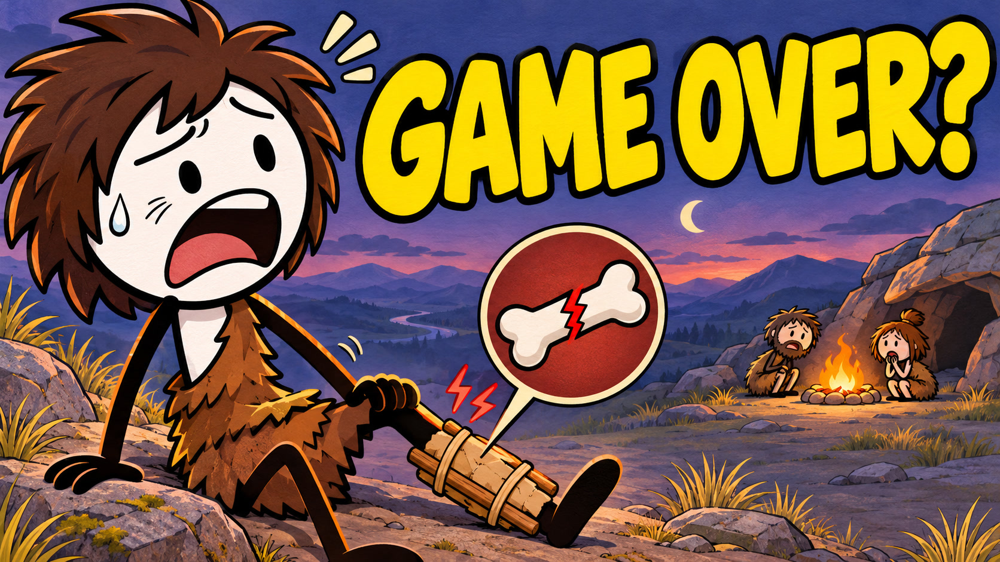

# Ancient Bergman · выпуск 02

## You Broke a Leg 30,000 Years Ago. Now What?

**Комплект подготовлен для новой озвучки. Финальный ролик с диктором ещё не собран.**

- [Весь комплект одним ZIP](https://github.com/mogilaortem-bot/firstsaitik/releases/download/broken-leg-production-v1/Ancient_Bergman_Broken_Leg_Production_Kit.zip)
- [8 текстов для ElevenLabs — ZIP](https://github.com/mogilaortem-bot/firstsaitik/releases/download/broken-leg-production-v1/ElevenLabs_8_Texts_EN.zip)
- [Предварительный монтаж начала — 44 секунды, 1080p, без диктора](https://github.com/mogilaortem-bot/firstsaitik/releases/download/broken-leg-production-v1/Opening_Preview_NO_VOICE.mp4)
- [Весь сценарий с источниками](Script_EN_with_sources.md)
- [Раскадровка](STORYBOARD.md)
- [Инструкция по озвучке и файлам](README_RU.md)
- [Обложка для загрузки — JPG](thumbnails/A_GAME_OVER_Upload.jpg)

В комплекте: английский сценарий на 1 202 слова, 24 иллюстрации для 32 сюжетных позиций, план из 90 монтажных кадров, 40 коротких текстовых акцентов, предварительные субтитры, источники и скрипт сборки начала. Расчётная длительность около 8:22; итог зависит от новых аудиозаписей.

Следующий шаг: озвучить восемь текстов из `voiceover/` тем же голосом и с теми же сохранёнными настройками ElevenLabs, что в первом выпуске. Сохранить исходные WAV или MP3 с указанными в инструкции именами. После этого можно точно синхронизировать весь выпуск.

[Страница комплекта и файлы по отдельности](https://github.com/mogilaortem-bot/firstsaitik/releases/tag/broken-leg-production-v1)
