# Раскадровка — Ancient Bergman, выпуск 02

Ниже — 32 сюжетные позиции, собранные из 24 иллюстраций. Повторные позиции используют другой план, надпись или возврат к герою. Тайминги предварительные, до новой озвучки.

## 01 · One bad step

### 0:00–0:04 · позиция 01

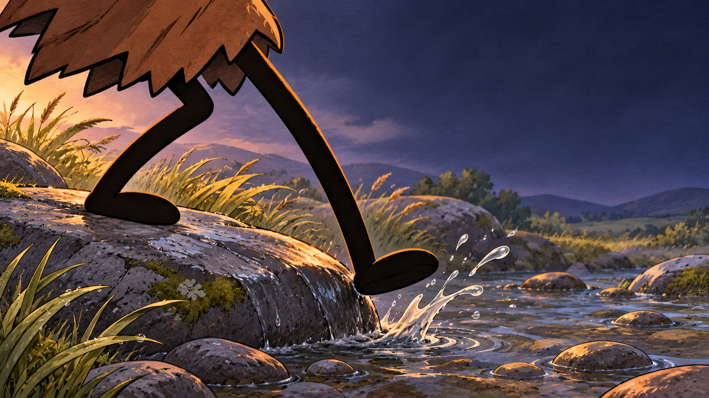

**Текст на экране:** ONE BAD STEP

One bad step. A crack. Your leg will not hold you.

### 0:04–0:13 · позиция 02

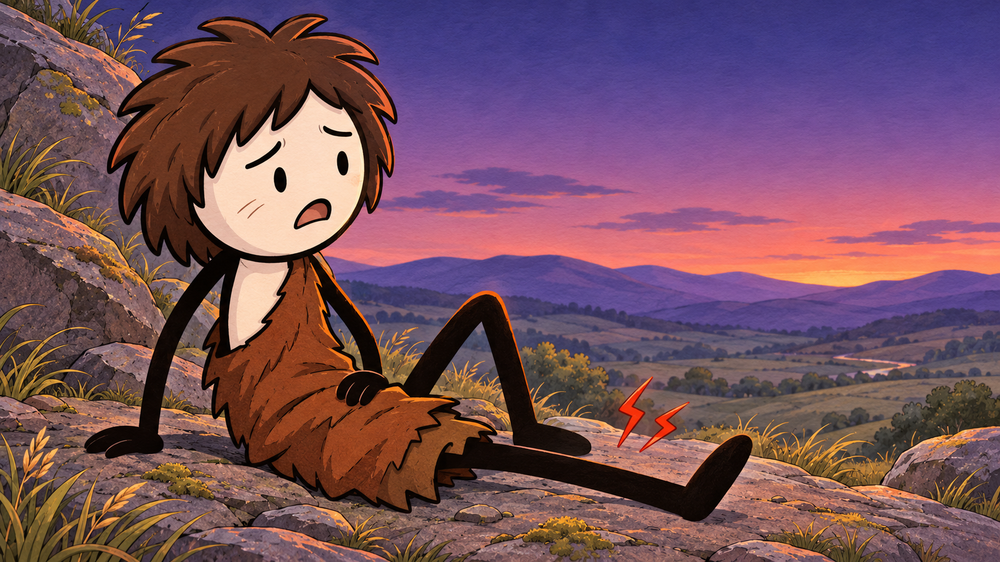

**Текст на экране:** 30,000 YEARS AGO

Now put that moment thirty thousand years in the past. No ambulance. No hospital. And the sun is going down.

### 0:13–0:15 · позиция 02

**Текст на экране:** GAME OVER?

Game over? Not necessarily.

### 0:15–0:24 · позиция 03

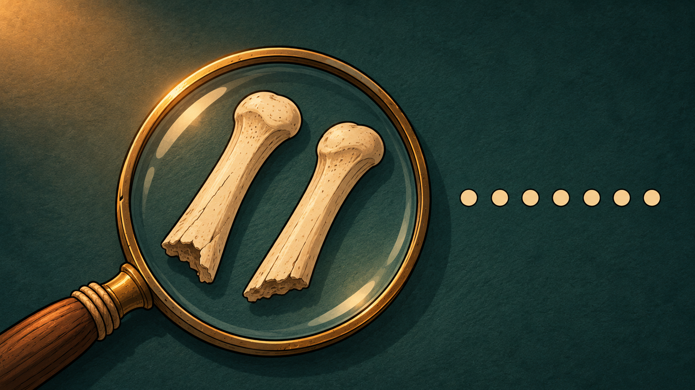

**Текст на экране:** YEARS AFTER THE INJURY

Archaeologists have found a person who survived a devastating leg injury for years. Some researchers think the damaged limb was deliberately amputated.

### 0:24–0:38 · позиция 04

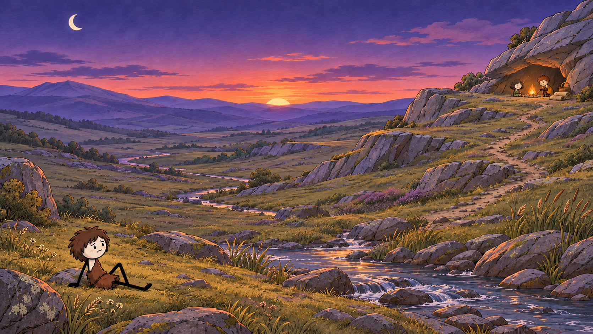

**Текст на экране:** FIRST: GET HOME

We will get to that remarkable case. First, our imaginary traveller has a more immediate problem. The shelter is over there. He is over here. And the space between them has suddenly become enormous.

### 0:38–0:44 · позиция 02

**Текст на экране:** без надписи

He checks the leg again. Still broken. This is going to complicate the afternoon.

## 02 · The landscape changes

### 0:44–0:59 · позиция 05

**Текст на экране:** THE SAME PATH. NEW RULES.

A few minutes ago, that slope was a shortcut. Now it is a wall. The stream was somewhere to drink. Now it is an obstacle. Nothing in the landscape has changed. Your ability to cross it has.

### 0:59–1:08 · позиция 06

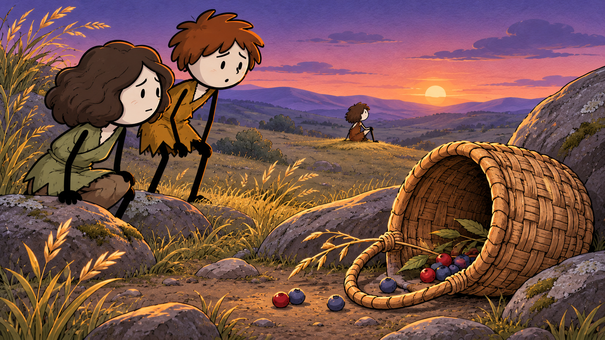

**Текст на экране:** WHO COMES BACK?

Our traveller is fictional. The problem is real: someone has to notice that you are missing before they can help.

### 1:08–1:23 · позиция 07

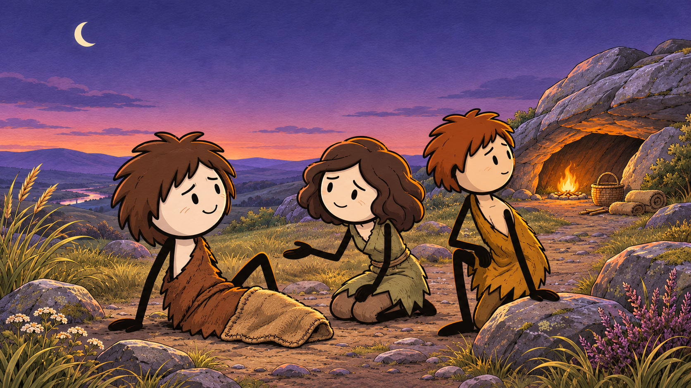

**Текст на экране:** HELP ARRIVES

In our story, two companions come back. One hears the shouting. The other sees the abandoned basket. They are not arriving with a magic cure. They are arriving with time, effort, and another pair of hands.

### 1:23–1:33 · позиция 08

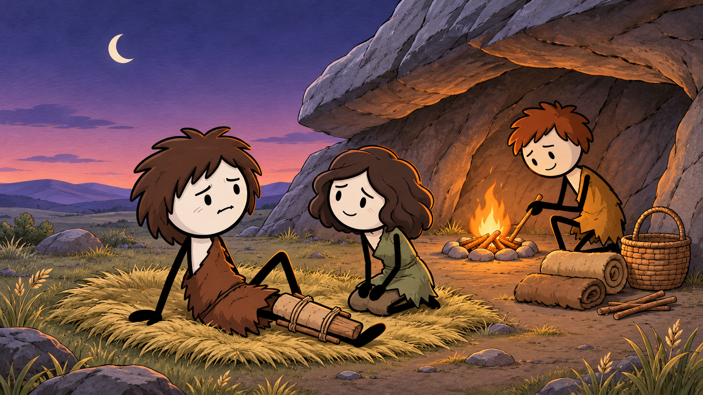

**Текст на экране:** HOME ≠ HEALED

Eventually, our traveller makes it back to shelter with help. The landscape has not become easier. He simply no longer has to cross it alone.

### 1:33–1:44 · позиция 08

**Текст на экране:** THE NEXT PROBLEM

For one glorious moment, being back at camp feels like the end of the problem. Then you look down. The leg has come home with you.

## 03 · Not every break is the same

### 1:44–1:56 · позиция 09

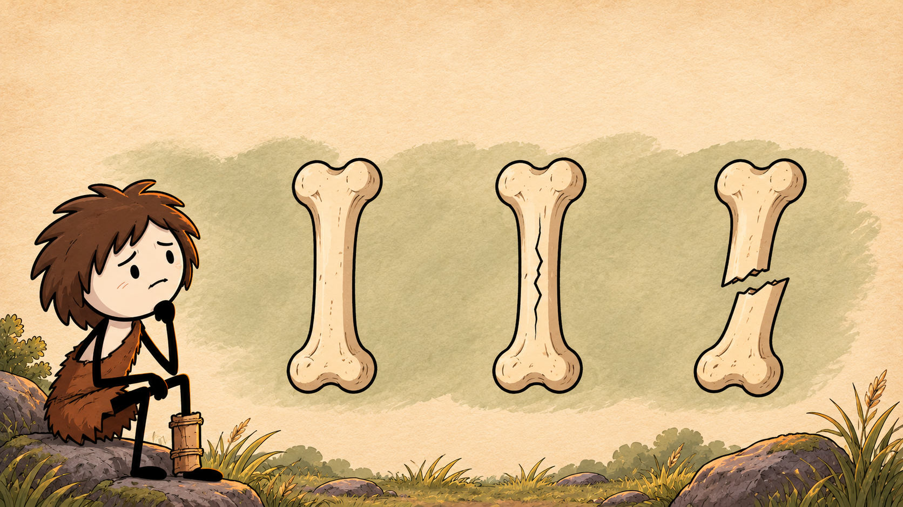

**Текст на экране:** NOT ALL BREAKS ARE EQUAL

A broken leg is not one single injury. A relatively stable fracture and a badly displaced break do not create the same problems. Damage to surrounding tissue matters too.

### 1:56–2:10 · позиция 10

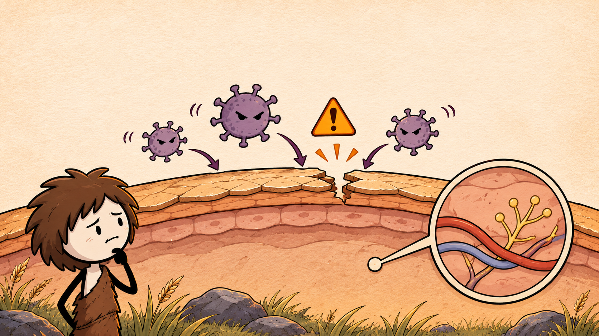

**Текст на экране:** SKIN IS A BARRIER

If the skin is broken, germs can enter the wound. Serious fractures can also threaten nearby blood vessels and nerves. Without modern treatment, those complications could make a bad situation much worse.

### 2:10–2:26 · позиция 11

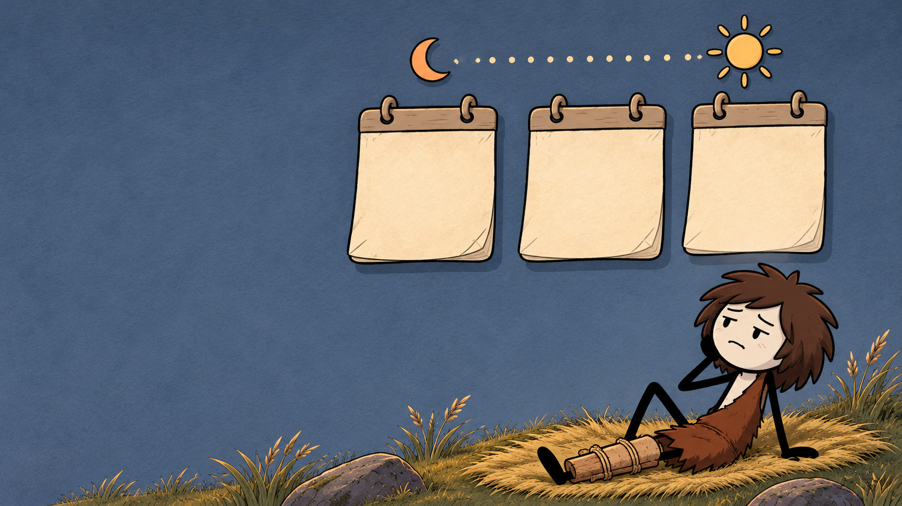

**Текст на экране:** WEEKS, NOT ONE NIGHT

And even an injury that heals does not heal overnight. Today, the NHS describes six to twelve weeks as a usual healing range for a broken leg, sometimes longer. That is a modern comparison, not an ancient recovery schedule.

### 2:26–2:42 · позиция 12

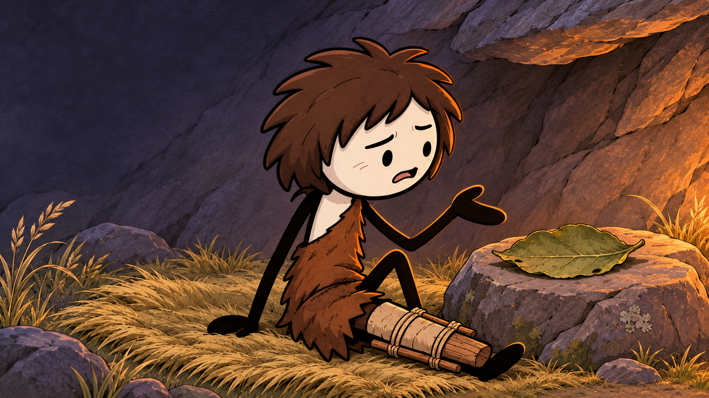

**Текст на экране:** TOMORROW. AND TOMORROW.

Our traveller was hoping for one uncomfortable evening. He is now looking at a much longer arrangement. Tomorrow he needs food. The next day he needs food. His body has absolutely no interest in how inconvenient this is.

### 2:42–2:53 · позиция 12

**Текст на экране:** WHO DOES YOUR JOB?

Which means the next threat might not look dramatic at all. It might look like an empty place where your share of the work used to be.

## 04 · Someone else's afternoon

### 2:53–3:06 · позиция 13

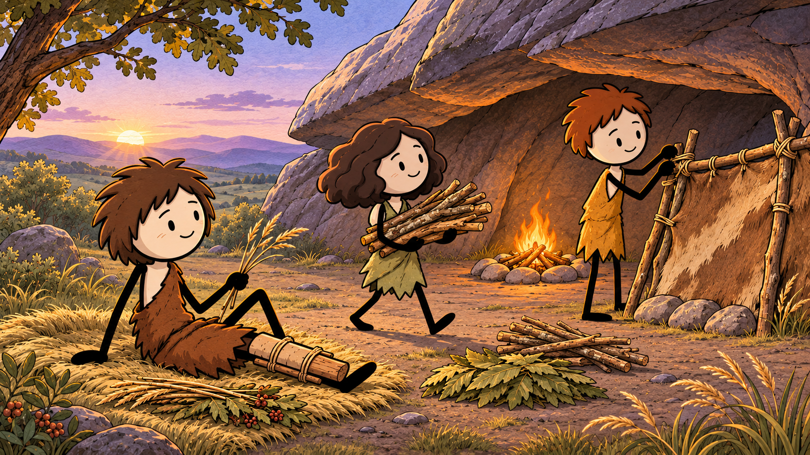

**Текст на экране:** ONE INJURY. MORE WORK.

Imagine the jobs that still need doing around this camp. Gathering fuel. Finding food. Carrying supplies. Maintaining shelter. The injury does not cancel any of them. It changes who can do them.

### 3:06–3:20 · позиция 14

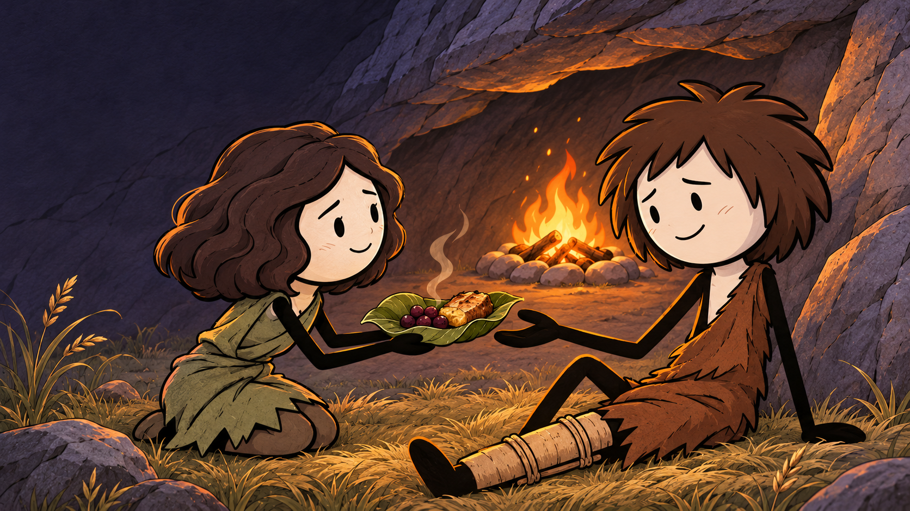

**Текст на экране:** CARE HAS A COST

Someone bringing you food is spending time they could spend elsewhere. Someone staying nearby may miss another task. Helping an injured person can be an ongoing commitment, not a single heroic gesture.

### 3:20–3:35 · позиция 15

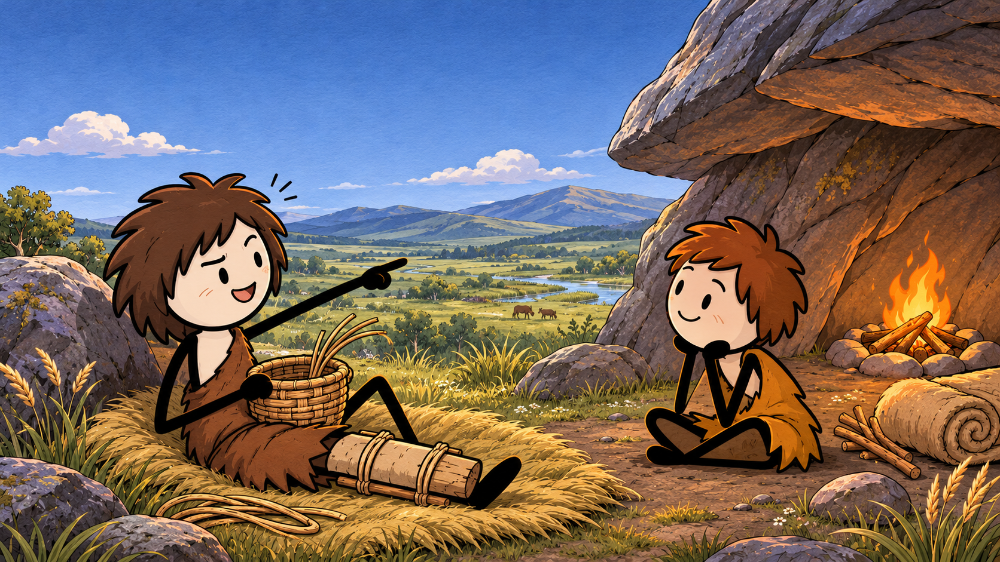

**Текст на экране:** LESS MOBILE ≠ LESS HUMAN

But needing help does not make someone useless. In our imaginary camp, the traveller can still share what he knows, watch what is happening, or work with his hands when he is able. His role can change.

### 3:35–3:50 · позиция 16

**Текст на экране:** CARE CAN LEAVE CLUES

We should not pretend every ancient group behaved alike. Researchers studying Neanderthals argue that care for injured people could make an important contribution to survival. The evidence includes injuries that healed while the person continued living.

### 3:50–4:01 · позиция 16

**Текст на экране:** SHOW ME THE BONES

That is a stronger clue than any scene we invent. So let us leave our traveller by the fire and meet someone whose bones actually survived.

## 05 · A real survivor

### 4:01–4:17 · позиция 17

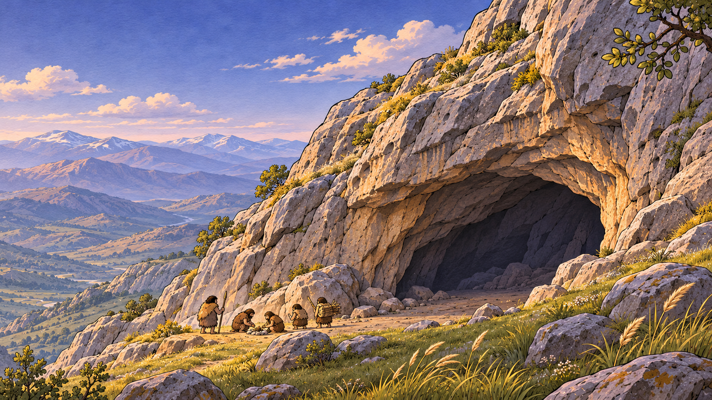

**Текст на экране:** SHANIDAR CAVE · IRAQ

At Shanidar Cave, in what is now Iraq, archaeologists found the remains of a Neanderthal known as Shanidar One. His case takes us beyond an imagined accident and into a body that carried its injuries for years.

### 4:17–4:33 · позиция 18

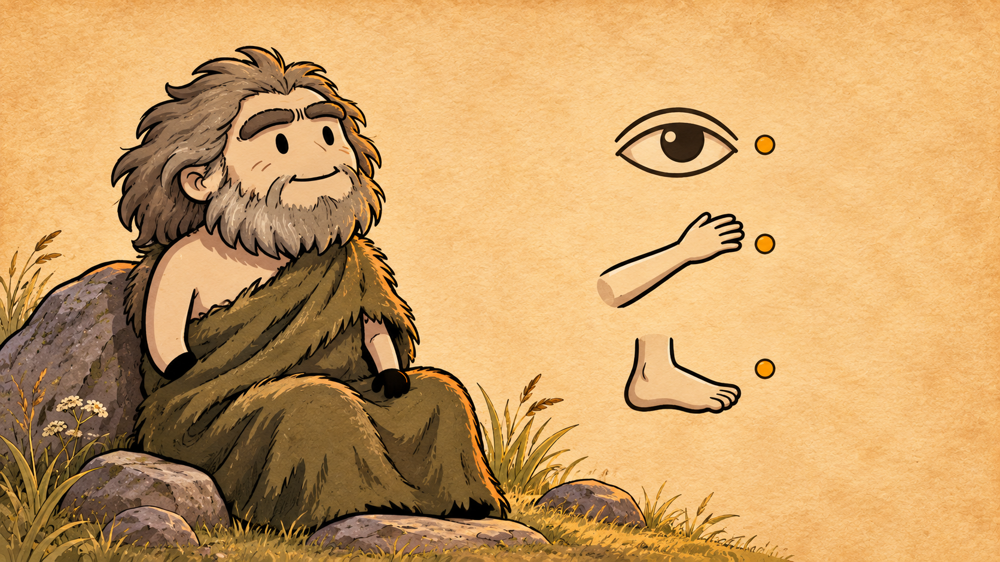

**Текст на экране:** SEVERAL INJURIES. HEALING.

His skeleton records several serious injuries. Researchers describe damage around the left eye, a severely impaired right arm, and a healed fracture in the right foot. Yet he lived into adulthood, with age at death estimated around thirty-five to forty-five.

### 4:33–4:46 · позиция 19

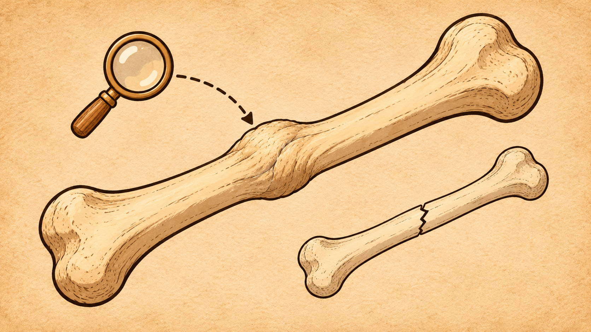

**Текст на экране:** SURVIVAL LEAVES A TRACE

That does not tell us every treatment he received. It does not let us name the people who helped. It does show that the injuries were not all immediate death sentences.

### 4:46–4:58 · позиция 20

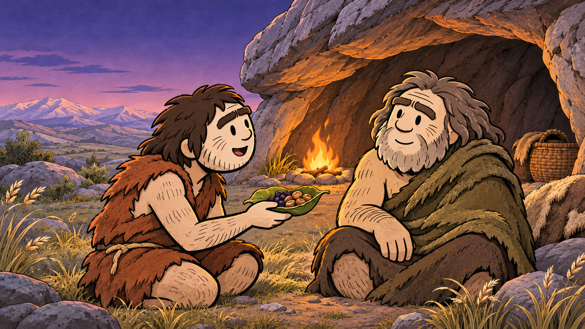

**Текст на экране:** SUPPORT IS AN INFERENCE

His survival is widely interpreted as evidence of support from others. The skeleton gives us injuries and healing. The daily work of care has to be reconstructed more cautiously.

### 4:58–5:11 · позиция 20

**Текст на экране:** THEN THERE IS BORNEO…

Still, the cartoon of prehistory where everyone simply abandons the injured is already looking shaky. And another discovery takes the question further. What if part of a leg was gone?

## 06 · The missing lower leg

### 5:11–5:25 · позиция 21

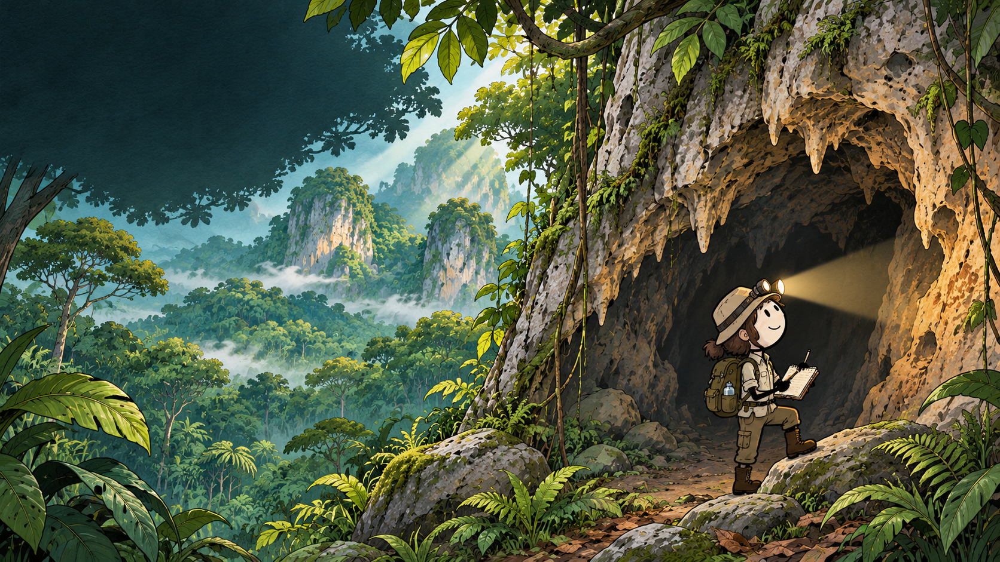

**Текст на экране:** BORNEO · ABOUT 31,000 YEARS AGO

In Liang Tebo cave, on the island of Borneo, researchers uncovered a burial about thirty-one thousand years old. The young adult inside was missing the left foot and part of the lower left leg.

### 5:25–5:36 · позиция 22

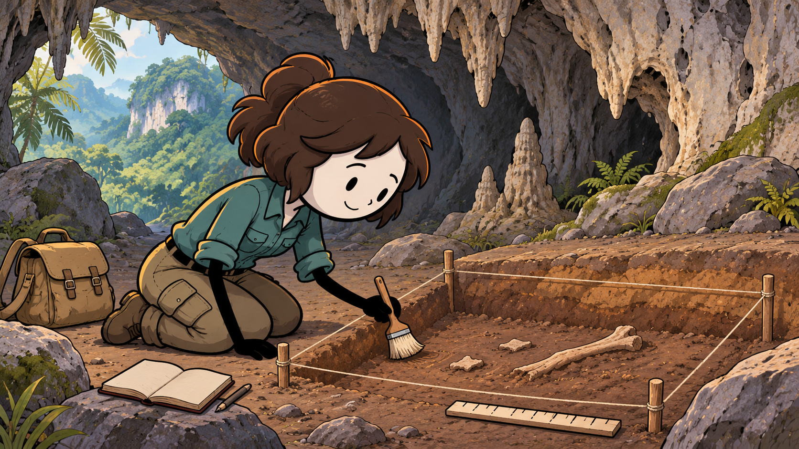

**Текст на экране:** MISSING IS ONLY THE START

Missing bones alone would not prove surgery. Bodies can be disturbed after burial. Here, the researchers examined something more revealing: changes in the surviving leg bones.

### 5:36–5:47 · позиция 23

**Текст на экране:** 6–9 YEARS · RESEARCH ESTIMATE

They identified extensive healing and argued that the person had lived for at least another six to nine years after the injury, which probably happened in childhood.

### 5:47–5:57 · позиция 24

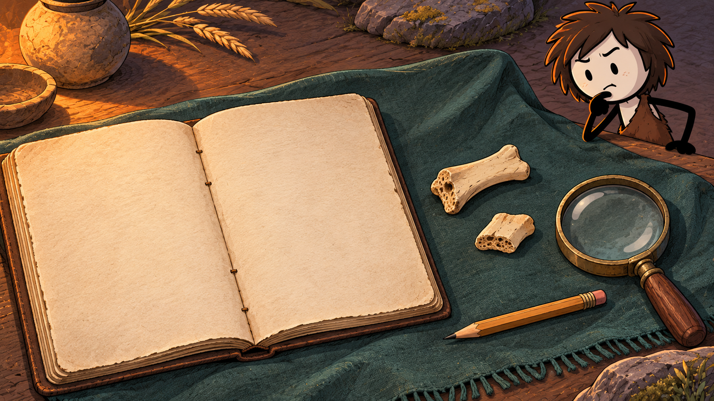

**Текст на экране:** SURGICAL AMPUTATION?

Their interpretation, published in Nature in twenty twenty-two, was deliberate surgical amputation. If correct, that places a successful operation astonishingly far back in time.

### 5:57–6:11 · позиция 24

**Текст на экране:** WHAT WE STILL DON'T KNOW

But the bones do not preserve the operator's name, the instrument, or a recipe for managing pain. And there is a twist the headline often leaves out: other specialists challenged the diagnosis.

## 07 · The evidence gets cross-examined

### 6:11–6:22 · позиция 25

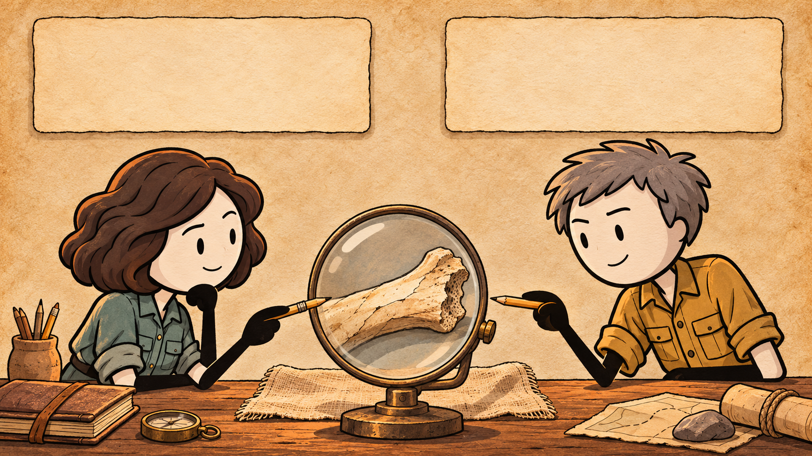

**Текст на экране:** SURGERY OR SEVERE TRAUMA?

In a published response, orthopaedic surgeons proposed a different explanation involving a severe fracture during growth. They argued that the skeletal changes did not require a deliberate operation.

### 6:22–6:35 · позиция 26

**Текст на экране:** THE ORIGINAL TEAM DISAGREED

The original researchers defended their conclusion. They said the location and form of the damage did not match that proposed fracture, and maintained that amputation best explained what they observed.

### 6:35–6:48 · позиция 27

**Текст на экране:** HEALING ≠ THE WHOLE STORY

Here is the difficult part. A bone can show that an injury healed. Reconstructing exactly what caused it is another question. Surviving a terrible injury and proving an operation are different claims.

### 6:48–7:02 · позиция 27

**Текст на экране:** THE TREATMENT IS UNKNOWN

We also cannot fill the missing details with a magical leaf, a miracle ointment, or an exact survival percentage. A dramatic possibility is still a possibility that has to answer to the bones.

### 7:02–7:14 · позиция 28

**Текст на экране:** BACK TO OUR TRAVELLER

And none of this makes a broken leg safe. It gives us a more interesting answer than instant doom. Injury, survival, skill, and help could exist in the same world.

## 08 · The next day

### 7:14–7:29 · позиция 29

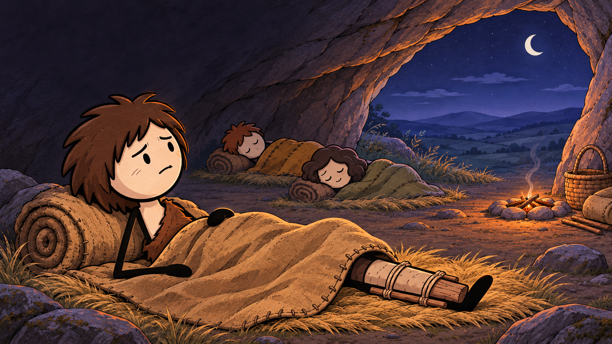

**Текст на экране:** NO GUARANTEED ENDING

Back at our imaginary camp, there is no guarantee of a happy ending. A severe injury could kill. An injury could heal badly. Someone might survive with lasting pain or a different way of moving.

### 7:29–7:43 · позиция 30

**Текст на экране:** ONE STEP WAS NOT THE WHOLE STORY

But look at what changed after that first crack. Other people found him. Shelter became reachable. Food kept arriving. The world did not become gentle. He stopped facing every part of it alone.

### 7:43–7:57 · позиция 31

**Текст на экране:** GAME OVER? NOT ALWAYS.

Would a broken leg end your life thirty thousand years ago? It could. But healed injuries show that it did not always do so. The outcome depended on the injury and the circumstances around it.

### 7:57–8:10 · позиция 32

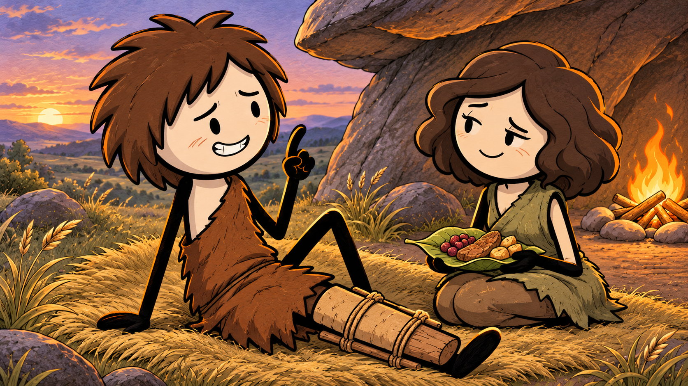

**Текст на экране:** SOMEONE CAME BACK

Our traveller notices a companion bringing another meal. At the start, we were staring at his leg. By the end, we should also be looking at the person who came back.

### 8:10–8:22 · позиция 32

**Текст на экране:** ANCIENT BERGMAN

Then he points toward the path and offers a helpful suggestion. Apparently, there is a shortcut. His companion looks at him. He decides not to finish that sentence.
